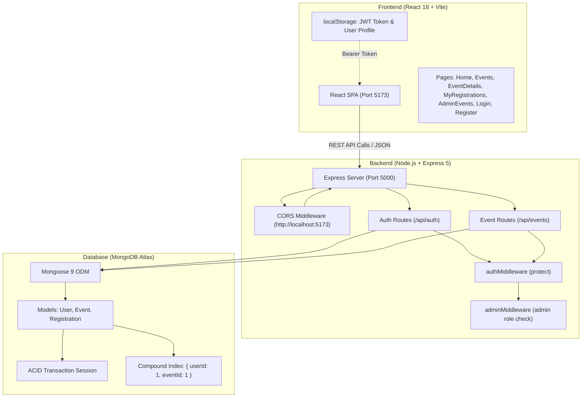

# UniVerse — University Event Management Platform

**UniVerse** is a full-stack university event discovery and registration platform built with **React (Vite)**, **Node.js (Express)**, **Mongoose**, and **MongoDB Atlas**. The platform enables students to browse upcoming campus events and register with atomic concurrency guarantees, while providing administrators with protected management tools to create, update, and manage campus events.

---

## Table of Contents

- [Features](#features)
  - [Student / User Features](#student--user-features)
  - [Administrator Features](#administrator-features)
- [Tech Stack](#tech-stack)
- [Architecture Overview](#architecture-overview)
- [Project Folder Structure](#project-folder-structure)
- [Prerequisites](#prerequisites)
- [Installation & Local Setup](#installation--local-setup)
- [Environment Variables Setup](#environment-variables-setup)
- [Running the Project Locally](#running-the-project-locally)
- [Admin Account Setup](#admin-account-setup)
- [API Documentation](#api-documentation)
- [Core Engineering Concepts](#core-engineering-concepts)
  - [JWT Authentication](#jwt-authentication)
  - [Role-Based Access Control (RBAC)](#role-based-access-control-rbac)
  - [Duplicate Registration Prevention](#duplicate-registration-prevention)
  - [ACID Transactions & Seat Concurrency](#acid-transactions--seat-concurrency)
- [Testing & Quality Assurance](#testing--quality-assurance)
- [Known Limitations & Deployment Notes](#known-limitations--deployment-notes)

---

## Features

### Student / User Features
- **User Registration**: Register an account with name, email, and password. Plaintext passwords are automatically hashed with bcrypt before storage, and accounts default to the `user` role.
- **User Authentication**: Login using credentials to receive a signed JWT token valid for 7 days. Client state updates dynamically using a window-level custom authentication event.
- **Public Event Catalog**: Browse all scheduled campus events sorted chronologically by date.
- **Event Details View**: Inspect full event details including date, time, venue, comprehensive description, total capacity, and real-time available seats.
- **Atomic Event Registration**: Reserve a seat for an event with immediate feedback. Prevents bookings when capacity is reached and blocks duplicate attempts.
- **My Registrations Dashboard**: Authenticated personal view displaying all events a user has registered for, populated with complete event details and sorted newest first.
- **Persistent Session & Logout**: Sessions persist in browser storage, with clean logout handling that clears credentials and updates UI across navigation components.

### Administrator Features
- **Admin Authentication Guard**: Server-side middleware and frontend route guards protect administrative actions, restricting access to users with `role: "admin"`.
- **Event Creation**: Admin dashboard form to publish new events with title, date, time, venue, description, total capacity, and initial available seats.
- **Event Updates**: Edit existing event schedules, descriptions, venues, or seat counts with schema validation enforced.
- **Safe Event Deletion**: Delete events with built-in referential protection: events with existing registrations cannot be deleted to avoid orphaned records.
- **Admin Seeding Script**: Dedicated backend script to bootstrap an administrator account in MongoDB Atlas.

---

## Tech Stack

| Layer | Technology | Details |
| :--- | :--- | :--- |
| **Frontend** | React 18 (`react`, `react-dom` `^18.3.1`) | Functional components, hooks (`useState`, `useEffect`) |
| **Build Tool** | Vite 5 (`vite` `^5.4.0`) | ESM dev server, Fast Refresh (`@vitejs/plugin-react` `^4.3.1`) |
| **Routing** | React Router DOM 7 (`^7.18.2`) | Client-side SPA navigation (`BrowserRouter`, `Routes`, `Route`) |
| **Styling** | Vanilla CSS | Modular, scoped CSS files per component and page |
| **Backend Runtime** | Node.js (CommonJS) | REST API server |
| **Web Framework** | Express 5 (`express` `^5.2.1`) | Middleware, JSON body parsing, route modularization |
| **Database & ODM** | MongoDB Atlas & Mongoose 9 (`^9.9.4`) | Cloud document store, schema models, ACID transactions, compound indexes |
| **Security & Auth** | JSON Web Tokens (`jsonwebtoken` `^9.0.3`) | Stateless HMAC-signed authorization tokens (7-day validity) |
| **Password Hashing** | bcryptjs (`^3.0.3`) | Salted cryptographic password hashing (10 salt rounds) |
| **CORS** | cors (`^2.8.6`) | Configured for `http://localhost:5173` |
| **Environment** | dotenv (`^17.4.2`) | Loads environment variables from `server/.env` |
| **Code Quality** | ESLint 9 (`eslint` `^9.8.0`) | React linting configuration in `client/eslint.config.js` |

---

## Architecture Overview

The system follows a decoupled three-tier client-server architecture:

```
┌────────────────────────────────────────────────────────┐
│             React Client (Vite @ Port 5173)            │
│  - SPA Pages (Home, Events, EventDetails, Admin, etc.) │
│  - State & LocalStorage (JWT Token, User Profile)      │
└───────────────────────────┬────────────────────────────┘
                            │
                            │ HTTP JSON Requests
                            │ Header: Authorization: Bearer <token>
                            ▼
┌────────────────────────────────────────────────────────┐
│           Express REST API (Node.js @ Port 5000)       │
│  - CORS Middleware (Origin: http://localhost:5173)     │
│  - JSON Body Parser                                    │
│  - Route Handlers (/api/auth, /api/events)             │
│  - Auth Middleware (protect) & Admin Guard             │
└───────────────────────────┬────────────────────────────┘
                            │
                            │ Mongoose 9 ODM Queries
                            │ Transaction Sessions & Compound Indexes
                            ▼
┌────────────────────────────────────────────────────────┐
│                   MongoDB Atlas Cluster                │
│  - Collections: users, events, registrations           │
│  - Compound Unique Index: { userId: 1, eventId: 1 }    │
│  - Multi-Document ACID Transactions (Replica Set)      │
└────────────────────────────────────────────────────────┘
```



---

## Project Folder Structure

```
campus_event_management_system/
├── client/                         # Frontend React + Vite SPA
│   ├── public/                     # Static assets
│   ├── src/
│   │   ├── assets/                 # Image & vector assets
│   │   ├── components/             # Reusable UI components
│   │   │   ├── EventCard.css       # Event card styles
│   │   │   ├── EventCard.jsx       # Event catalog card component
│   │   │   ├── Navbar.css          # Navigation bar styles
│   │   │   └── Navbar.jsx          # Header with reactive auth state
│   │   ├── data/
│   │   │   └── mockEvents.js       # Static mock event reference data
│   │   ├── pages/                  # Routed page views
│   │   │   ├── AdminEvents.css     # Admin dashboard styles
│   │   │   ├── AdminEvents.jsx     # Admin CRUD event management dashboard
│   │   │   ├── EventDetails.css    # Event details & registration styles
│   │   │   ├── EventDetails.jsx    # Single event view & registration trigger
│   │   │   ├── Events.css          # Catalog styles
│   │   │   ├── Events.jsx          # Public event listings catalog
│   │   │   ├── Home.css            # Landing page styles
│   │   │   ├── Home.jsx            # Hero landing page
│   │   │   ├── Login.css           # Login form styles
│   │   │   ├── Login.jsx           # User & admin login view
│   │   │   ├── MyRegistrations.css # Registration dashboard styles
│   │   │   ├── MyRegistrations.jsx # Registered events page for logged-in user
│   │   │   ├── Register.css        # Registration styles
│   │   │   └── Register.jsx        # Account registration view
│   │   ├── App.css                 # Application layout styles
│   │   ├── App.jsx                 # Route definitions & layout shell
│   │   ├── index.css               # Global CSS reset and typography
│   │   └── main.jsx                # React DOM root entry point
│   ├── eslint.config.js            # ESLint flat config
│   ├── index.html                  # HTML template
│   ├── package.json                # Frontend dependencies and scripts
│   └── vite.config.js              # Vite bundler configuration
├── server/                         # Backend Express REST API
│   ├── config/
│   │   └── db.js                   # Mongoose connection to MongoDB Atlas
│   ├── middleware/
│   │   ├── adminMiddleware.js      # Role authorization guard (admin check)
│   │   └── authMiddleware.js       # JWT extraction and verification guard
│   ├── models/
│   │   ├── Event.js                # Event schema & model
│   │   ├── Registration.js         # Registration schema & compound unique index
│   │   └── User.js                 # User schema & model
│   ├── routes/
│   │   ├── authRoutes.js           # /api/auth registration and login routes
│   │   └── eventRoutes.js          # /api/events CRUD and booking routes
│   ├── scripts/
│   │   └── createAdmin.js          # CLI script to create/promote admin account
│   ├── package.json                # Backend dependencies and scripts
│   └── server.js                   # Express application entry point
├── .gitignore                      # Git ignored files (node_modules, .env, dist)
└── README.md                       # Master project documentation
```

---

## Prerequisites

Before setting up the project locally, verify that you have the following installed:

- **Node.js**: `v18.0.0` or higher (tested with Node `v24.x`; required for native `node --watch` support and Express 5).
- **npm**: `v9.0.0` or higher (packaged with Node.js).
- **MongoDB Atlas Cluster**: A running MongoDB instance configured as a replica set (MongoDB Atlas provides replica sets by default), required for Mongoose multi-document transactions.
- **Git**: For source control cloning and commits.

---

## Installation & Local Setup

### 1. Clone the Repository

```bash
git clone https://github.com/DevGoyal9238/campus-event-management-system.git
cd campus-event-management-system
```

### 2. Backend Dependencies Installation

Navigate into `server/` and install dependencies:

```bash
cd server
npm install
```

### 3. Frontend Dependencies Installation

Open another terminal or navigate into `client/` and install dependencies:

```bash
cd ../client
npm install
```

---

## Environment Variables Setup

The backend requires a `.env` file located inside the `server/` directory to connect to MongoDB Atlas and sign JWT tokens.

Create a file named `.env` in `server/`:

```bash
# Inside campus_event_management_system/server/
touch .env
```

Add the following environment variables (replace placeholder values with your credentials):

```env
# Port on which the Express server listens (default: 5000)
PORT=5000

# MongoDB Atlas connection string (must connect to a replica set/Atlas for transactions)
MONGO_URI=mongodb+srv://<username>:<password>@<cluster>.mongodb.net/<database>?retryWrites=true&w=majority

# Cryptographic secret key used to sign and verify JSON Web Tokens
JWT_SECRET=your_jwt_secret_key_here
```

> **Security Note**: Never commit your real `.env` file or credentials to Git. `server/.env` is ignored by `.gitignore`.

*Frontend Note*: The React client communicates with `http://localhost:5000` directly as configured in the source code; no `.env` file is required for local frontend development.

---

## Running the Project Locally

Run the backend and frontend simultaneously in two separate terminals.

### Terminal 1: Start the Backend Server

```bash
cd server
npm run dev
```

- This runs `node --watch server.js`, which restarts the server automatically when server files change.
- The server starts on `http://localhost:5000`.
- Verify the server is running by opening: `http://localhost:5000/api/health` in your browser. Expected response:
  ```json
  { "message": "Campus Event API is running" }
  ```

### Terminal 2: Start the Frontend Client

```bash
cd client
npm run dev
```

- This launches Vite's local dev server.
- The client is accessible at: `http://localhost:5173`.
- Open `http://localhost:5173` in your browser to interact with the application.

---

## Admin Account Setup

By default, any user registered through the `/register` web interface receives the standard `user` role. To perform administrative operations (create, update, delete events), an account with `role: "admin"` is required.

An admin seeding utility is provided in `server/scripts/createAdmin.js`:

```bash
cd server
node scripts/createAdmin.js
```

**What this script does:**
1. Connects to the database specified in `server/.env`.
2. Checks whether `admin@campusevents.com` exists.
3. If the user does not exist, it creates a new administrator account with:
   - **Name**: `System Administrator`
   - **Email**: `admin@campusevents.com`
   - **Password**: `AdminPassword123` (hashed via bcrypt)
   - **Role**: `admin`
4. If the user already exists, it elevates their role to `admin`.

Once executed, navigate to `http://localhost:5173/login` and log in with these credentials to access the **🛡️ Admin** dashboard.

---

## API Documentation

All API routes are served under the `/api` prefix on `http://localhost:5000`.

### Summary of Endpoints

| Method | Endpoint | Access Level | Description |
| :--- | :--- | :--- | :--- |
| `GET` | `/api/health` | Public | System health check route |
| `POST` | `/api/auth/register` | Public | Register new user with hashed password |
| `POST` | `/api/auth/login` | Public | Authenticate user credentials and return JWT |
| `GET` | `/api/events` | Public | Fetch all events sorted by date (ascending) |
| `GET` | `/api/events/:id` | Public | Fetch a single event by its MongoDB ObjectId |
| `GET` | `/api/events/my-registrations` | Protected (User) | Fetch registered events for authenticated user |
| `POST` | `/api/events` | Protected (Admin) | Create a new campus event |
| `PUT` | `/api/events/:id` | Protected (Admin) | Update an existing campus event |
| `DELETE` | `/api/events/:id` | Protected (Admin) | Delete an event (blocked if registrations exist) |
| `POST` | `/api/events/:id/register` | Protected (User) | Register user for event using ACID transaction |

---

### Detailed Endpoint Specifications

#### 1. System Health Check
- **`GET /api/health`**
  - **Access**: Public
  - **Response `200 OK`**:
    ```json
    {
      "message": "Campus Event API is running"
    }
    ```

---

#### 2. Authentication Endpoints

- **`POST /api/auth/register`**
  - **Access**: Public
  - **Request Body**:
    ```json
    {
      "name": "Jane Doe",
      "email": "jane@campus.edu",
      "password": "Password123"
    }
    ```
  - **Response `201 Created`**:
    ```json
    {
      "message": "User registered successfully",
      "user": {
        "_id": "670...",
        "name": "Jane Doe",
        "email": "jane@campus.edu",
        "role": "user",
        "createdAt": "2026-10-10T08:00:00.000Z"
      }
    }
    ```
  - **Error Responses**: `400 Bad Request` (Missing fields or email already exists), `500 Internal Server Error`.

- **`POST /api/auth/login`**
  - **Access**: Public
  - **Request Body**:
    ```json
    {
      "email": "jane@campus.edu",
      "password": "Password123"
    }
    ```
  - **Response `200 OK`**:
    ```json
    {
      "message": "Login successful",
      "token": "eyJhbGciOiJIUzI1NiIsInR5cCI6IkpXVCJ9...",
      "user": {
        "_id": "670...",
        "name": "Jane Doe",
        "email": "jane@campus.edu",
        "role": "user"
      }
    }
    ```
  - **Error Responses**: `400 Bad Request` (Missing fields), `401 Unauthorized` (Invalid email or password).

---

#### 3. Event Catalog & Registrations

- **`GET /api/events`**
  - **Access**: Public
  - **Description**: Returns all events sorted chronologically by date (`date: 1`).
  - **Response `200 OK`**:
    ```json
    [
      {
        "_id": "6707f...",
        "title": "Annual Campus Hackathon 2026",
        "date": "2026-10-25T00:00:00.000Z",
        "time": "09:00 AM - 06:00 PM",
        "venue": "Main Auditorium",
        "description": "24-hour hackathon for building student projects.",
        "totalCapacity": 100,
        "availableSeats": 42,
        "createdAt": "2026-10-10T00:00:00.000Z",
        "updatedAt": "2026-10-10T00:00:00.000Z"
      }
    ]
    ```

- **`GET /api/events/:id`**
  - **Access**: Public
  - **Response `200 OK`**: Returns single event object.
  - **Error Responses**: `400 Bad Request` (Invalid ID format), `404 Not Found` (Event not found).

- **`GET /api/events/my-registrations`**
  - **Access**: Private (Requires `Authorization: Bearer <token>`)
  - **Response `200 OK`**:
    ```json
    {
      "registrations": [
        {
          "_id": "6708a...",
          "userId": "670...",
          "eventId": {
            "_id": "6707f...",
            "title": "Annual Campus Hackathon 2026",
            "date": "2026-10-25T00:00:00.000Z",
            "time": "09:00 AM - 06:00 PM",
            "venue": "Main Auditorium",
            "description": "24-hour hackathon for building student projects.",
            "totalCapacity": 100,
            "availableSeats": 42
          },
          "createdAt": "2026-10-10T01:30:00.000Z"
        }
      ]
    }
    ```
  - **Error Responses**: `401 Unauthorized` (Missing or invalid token).

- **`POST /api/events/:id/register`**
  - **Access**: Private (Requires `Authorization: Bearer <token>`)
  - **Description**: Atomically registers the authenticated user and decrements `availableSeats` using a transaction session.
  - **Response `200 OK`**: Returns updated event object with decremented `availableSeats`.
  - **Error Responses**:
    - `400 Bad Request`: `Invalid event ID format`, `No seats available for this event`, or `Already registered for this event`.
    - `401 Unauthorized`: Token missing or expired.
    - `404 Not Found`: Event does not exist.

---

#### 4. Admin Event Management

All endpoints require `Authorization: Bearer <admin_token>`.

- **`POST /api/events`**
  - **Access**: Private (`admin` role required)
  - **Request Body**:
    ```json
    {
      "title": "AI & Robotics Workshop",
      "date": "2026-11-15",
      "time": "02:00 PM - 05:00 PM",
      "venue": "Lab 4, Engineering Block",
      "description": "Practical workshop on reinforcement learning.",
      "totalCapacity": 60,
      "availableSeats": 60
    }
    ```
  - **Response `201 Created`**: Returns created event object.
  - **Error Responses**: `400 Bad Request` (Validation error), `403 Forbidden` (`Admin access required`).

- **`PUT /api/events/:id`**
  - **Access**: Private (`admin` role required)
  - **Request Body**: Updated fields (matches event schema).
  - **Response `200 OK`**: Returns modified event document.
  - **Error Responses**: `400 Bad Request`, `403 Forbidden`, `404 Not Found`.

- **`DELETE /api/events/:id`**
  - **Access**: Private (`admin` role required)
  - **Description**: Deletes an event. If any user has already registered for this event (`Registration.countDocuments > 0`), the deletion is blocked to prevent dangling records.
  - **Response `200 OK`**:
    ```json
    {
      "message": "Event deleted successfully"
    }
    ```
  - **Error Responses**:
    - `400 Bad Request`: `"Cannot delete an event with existing registrations"`
    - `403 Forbidden`: `"Admin access required"`
    - `404 Not Found`: `"Event not found"`

---

## Core Engineering Concepts

### JWT Authentication
1. **Token Issuance**: Upon successful login, the server generates a JSON Web Token signed with `process.env.JWT_SECRET` containing the user ID and role:
   ```javascript
   jwt.sign({ userId: user._id, role: user.role || 'user' }, process.env.JWT_SECRET, { expiresIn: '7d' });
   ```
2. **Client Storage & Propagation**: The client stores the token and user profile in `localStorage`. Subsequent authenticated requests include the token in the `Authorization` header (`Bearer <token>`).
3. **Verification**: The `protect` middleware verifies the cryptographic signature with `jwt.verify()`. Upon success, it attaches `req.userId` and `req.userRole` to the request object. If invalid or expired, it returns `401 Unauthorized`.

### Role-Based Access Control (RBAC)
- All new users registering via `POST /api/auth/register` are assigned `role: 'user'` on the server regardless of client input.
- Protected admin routes pass through `adminMiddleware`:
  ```javascript
  const adminMiddleware = (req, res, next) => {
    if (req.userRole !== 'admin') {
      return res.status(403).json({ message: 'Admin access required' });
    }
    next();
  };
  ```
- The frontend dynamically displays the **🛡️ Admin** link in `Navbar.jsx` only when `currentUser.role === 'admin'`, and `AdminEvents.jsx` renders access-denied state cards if accessed without admin rights.

### Duplicate Registration Prevention
Duplicate registrations are prevented at both the application level and the database level:
1. **Application Level**: Inside the registration endpoint, the database is queried for an existing registration matching both `userId` and `eventId`. If found, the transaction is aborted with `400 Already registered for this event`.
2. **Database Level (Enforced Guarantee)**: In `server/models/Registration.js`, a compound unique index is created on `{ userId: 1, eventId: 1 }`:
   ```javascript
   registrationSchema.index({ userId: 1, eventId: 1 }, { unique: true });
   ```
   Even if two requests pass the application check simultaneously, MongoDB rejects the second insert with a duplicate key error (`code: 11000`), preventing duplicate records under race conditions.

### ACID Transactions & Seat Concurrency
To ensure data consistency between registration records and available seats, the registration endpoint (`POST /api/events/:id/register`) uses a multi-document ACID transaction:
1. **Session Initialization**: `const session = await mongoose.startSession(); session.startTransaction();`
2. **Availability Check**: Verifies `event.availableSeats > 0` within the active session.
3. **Atomic Decrement with Query Guard**:
   ```javascript
   const updatedEvent = await Event.findOneAndUpdate(
     { _id: id, availableSeats: { $gt: 0 } },
     { $inc: { availableSeats: -1 } },
     { new: true, runValidators: true, session }
   );
   ```
   The conditional check `{ availableSeats: { $gt: 0 } }` ensures that seats cannot decrement below zero even during concurrent writes.
4. **Registration Record Creation**: Inserts the new `Registration` document inside the same session.
5. **Commit / Rollback**: If either operation fails or seats are exhausted, `session.abortTransaction()` reverts all writes. The transaction commits only when both operations succeed.
6. **Session Cleanup**: `session.endSession()` is guaranteed in a `finally` block to prevent connection leaks.

---

## Testing & Quality Assurance

### Automated Testing Status
- **Current State**: Automated test suites (e.g., Jest, Vitest, Mocha, Supertest) are not currently configured in the repository.
- <!-- TODO: Add automated unit and integration test suites (e.g. Vitest for client, Jest/Supertest for server routes) -->

### Available Code Quality Script

- **Frontend Linting**:
  To execute ESLint checks across the React codebase:
  ```bash
  cd client
  npm run lint
  ```

### Manual Verification Checklist
1. **Health Check**: Open `http://localhost:5000/api/health` and verify the status message.
2. **User Registration & Login**: Register a new student account at `http://localhost:5173/register`, log in at `/login`, and verify token storage in browser `localStorage`.
3. **Event Booking**: Navigate to `/events`, select an event, click "Register for Event", and confirm the available seat count decrements by 1.
4. **Duplicate Prevention Check**: Attempt to register for the same event again; verify that the system blocks the registration with `"Already registered for this event"`.
5. **My Registrations**: Open `/my-registrations` and verify the newly booked event appears in the list.
6. **Admin Authorization Guard**: Run `node scripts/createAdmin.js` in `server/`, log in with `admin@campusevents.com`, and verify access to `/admin/events` for creating and updating events.

---

## Known Limitations & Deployment Notes

- **Client API Base URL**: Client components (`Events.jsx`, `EventDetails.jsx`, `Login.jsx`, etc.) currently hardcode `http://localhost:5000` as the API host. For production deployment, configure an environment variable (e.g., `import.meta.env.VITE_API_BASE_URL`).
- <!-- TODO: Refactor hardcoded http://localhost:5000 in client components to use import.meta.env.VITE_API_BASE_URL -->
- **Token Storage**: JWT tokens are stored in browser `localStorage`. For production hardening against XSS vulnerabilities, consider migrating to `httpOnly` secure cookies.
- <!-- TODO: Migrate JWT token storage from localStorage to secure httpOnly cookies -->
- **MongoDB Replica Set Requirement**: Multi-document ACID transactions require MongoDB Atlas or a local replica set. Standalone local MongoDB instances without replica sets will reject transaction sessions.
- **CORS Configuration**: In `server/server.js`, CORS is restricted to `http://localhost:5173`. When deploying to production, update the allowed origin to the production frontend URL.
- <!-- TODO: Parameterize CORS origin via environment variables for staging/production deployment -->
- **Registration Cancellation**: The API and UI currently support event registration and viewing bookings, but do not provide an endpoint or UI button to cancel an existing registration or release a seat back to inventory.
- <!-- TODO: Implement DELETE /api/events/:id/register or cancel registration endpoint with transactional seat increment -->
- **Production Builds**:
  - Frontend: `npm run build` in `client/` produces an optimized static build in `client/dist/`.
  - Backend: `npm start` in `server/` runs `node server.js` without `--watch`.
