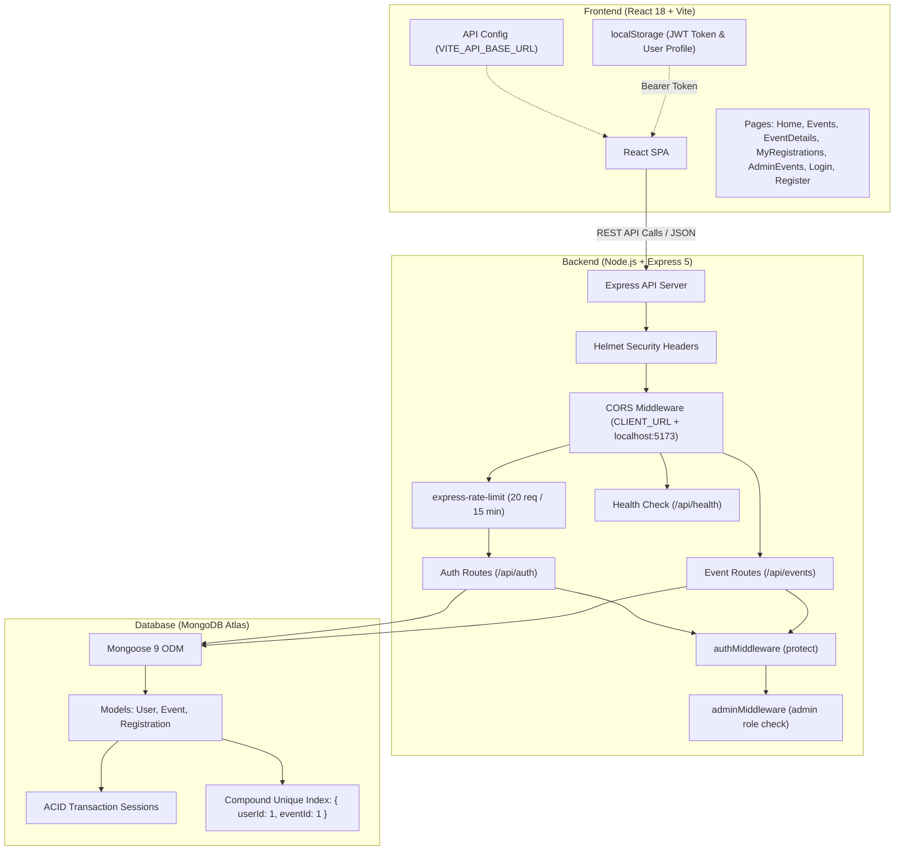

# UniVerse — University Event Management Platform

UniVerse is a full-stack campus event discovery and registration platform built with **React 18 (Vite)**, **Node.js (Express 5)**, **Mongoose 9**, and **MongoDB Atlas**. It enables students to explore upcoming campus events, view real-time seat availability, and book tickets with concurrency guarantees, while providing administrators with secure, role-protected tools to create, edit, and manage event schedules.

- **Live Demo**: [https://campus-event-management-system-seven.vercel.app](https://campus-event-management-system-seven.vercel.app/)
- **Repository**: [https://github.com/DevGoyal9238/campus-event-management-system](https://github.com/DevGoyal9238/campus-event-management-system)
- **Deployed Backend Health Check**: [https://universe-api-6aoq.onrender.com/api/health](https://universe-api-6aoq.onrender.com/api/health)

---

## Table of Contents

- [Features](#features)
  - [Student & Attendee Features](#student--attendee-features)
  - [Administrator Features](#administrator-features)
- [Tech Stack](#tech-stack)
- [Architecture & Data Flow](#architecture--data-flow)
- [Project Folder Structure](#project-folder-structure)
- [Prerequisites](#prerequisites)
- [Installation & Local Setup](#installation--local-setup)
- [Environment Variables](#environment-variables)
- [Running the Application Locally](#running-the-application-locally)
- [Administrator Account Setup](#administrator-account-setup)
- [API Documentation](#api-documentation)
  - [Summary of Endpoints](#summary-of-endpoints)
  - [Detailed Endpoint Specifications](#detailed-endpoint-specifications)
- [Core Engineering Concepts](#core-engineering-concepts)
  - [JWT Authentication & Client Storage](#jwt-authentication--client-storage)
  - [Role-Based Access Control (RBAC)](#role-based-access-control-rbac)
  - [Concurrency Control & ACID Transactions](#concurrency-control--acid-transactions)
  - [Duplicate Registration Prevention](#duplicate-registration-prevention)
  - [Security Headers & Rate Limiting](#security-headers--rate-limiting)
- [Testing & Quality Assurance](#testing--quality-assurance)
  - [Automated Testing Status](#automated-testing-status)
  - [Code Quality & Linting](#code-quality--linting)
  - [Manual Verification Checklist](#manual-verification-checklist)
- [Deployment](#deployment)
- [Known Limitations](#known-limitations)

---

## Features

### Student & Attendee Features
- **Account Registration & Authentication**: Create an account with name, email, and password. Passwords are securely hashed with bcrypt (10 salt rounds), accounts default to the `user` role, and logins issue a signed 7-day JWT token.
- **Public Event Catalog**: Discover scheduled campus events sorted chronologically by date (`date: 1`).
- **Detailed Event View**: View comprehensive event descriptions, date, time, venue, total capacity, and real-time available seats.
- **Atomic Event Registration**: Reserve a seat with immediate UI feedback. Multi-document database transactions ensure seats decrement atomically and prevent overselling.
- **My Registrations Dashboard**: Authenticated personal dashboard displaying all events the student has booked, populated with full event details and sorted newest first (`createdAt: -1`).
- **Client Session Management**: Sessions persist in browser `localStorage`, with reactive logout handlers updating UI navigation state across components.

### Administrator Features
- **Role-Protected Admin Panel**: Administrative actions are guarded by backend middleware (`adminMiddleware`) and frontend route protection, restricting operations to users with `role: "admin"`.
- **Event Creation**: Form interface to publish new events with title, schedule, venue, description, total capacity, and initial seat count.
- **Event Updates**: Edit existing event schedules, descriptions, venues, or seat counts with schema validation enforced.
- **Safe Event Deletion**: Prevent orphaned records by blocking deletion of events that already have registered attendees (`Registration.countDocuments > 0`).
- **CLI Admin Account Provisioning**: Dedicated script (`server/scripts/createAdmin.js`) to safely create or elevate an administrator account via environment variables without hardcoded credentials.

---

## Tech Stack

| Layer | Technology | Version / Package | Details |
| :--- | :--- | :--- | :--- |
| **Frontend Framework** | React 18 | `react`, `react-dom` `^18.3.1` | Component-driven UI using hooks (`useState`, `useEffect`) |
| **Build Tool & Bundler** | Vite 5 | `vite` `^5.4.0`, `@vitejs/plugin-react` `^4.3.1` | ESM development server, HMR, and optimized production builds |
| **Client Routing** | React Router DOM 7 | `react-router-dom` `^7.18.2` | Client-side Single Page Application (SPA) routing |
| **Styling** | Vanilla CSS | Scoped stylesheets | Responsive CSS layouts without external CSS utility frameworks |
| **Backend Runtime** | Node.js | CommonJS module system | Event-driven JavaScript runtime environment |
| **Web Framework** | Express 5 | `express` `^5.2.1` | REST API routing, middleware pipeline, and JSON body parsing |
| **Database & ODM** | MongoDB Atlas & Mongoose 9 | `mongoose` `^9.9.4` | Cloud document database, schema validation, ACID transactions |
| **Authentication** | JSON Web Tokens | `jsonwebtoken` `^9.0.3` | Stateless Bearer token authentication (7-day validity) |
| **Password Hashing** | bcryptjs | `bcryptjs` `^3.0.3` | Cryptographic salted hashing (10 salt rounds) |
| **Security Headers** | Helmet | `helmet` `^8.3.0` | Sets HTTP response headers (`crossOriginResourcePolicy: 'cross-origin'`) |
| **Rate Limiting** | express-rate-limit | `express-rate-limit` `^8.7.1` | Throttles brute-force attempts on authentication endpoints |
| **CORS** | cors | `cors` `^2.8.6` | Dynamic origin validation (`http://localhost:5173` + `CLIENT_URL`) |
| **Environment Management** | dotenv | `dotenv` `^17.4.2` | Loads environment variables from `.env` files |
| **Code Quality** | ESLint 9 | `eslint` `^9.8.0` | Static code analysis and linting for React source code |

---

## Architecture & Data Flow

```
┌─────────────────────────────────────────────────────────────────┐
│               React SPA Client (Vite / Vercel)                  │
│  - Dynamic API URL from VITE_API_BASE_URL (client/src/config)  │
│  - Auth state & JWT token stored in browser localStorage        │
└───────────────────────────────┬─────────────────────────────────┘
                                │
                                │ HTTP JSON Requests
                                │ Header: Authorization: Bearer <token>
                                ▼
┌─────────────────────────────────────────────────────────────────┐
│            Express REST API Server (Node.js / Render)           │
│  - Security Headers: Helmet (cross-origin resource policy)      │
│  - Dynamic CORS: http://localhost:5173 + CLIENT_URL             │
│  - Rate Limiting: authLimiter (20 req / 15 min on /api/auth)    │
│  - Auth Guards: protect (JWT) & adminMiddleware (role: admin)   │
└───────────────────────────────┬─────────────────────────────────┘
                                │
                                │ Mongoose 9 ODM Queries
                                │ Multi-Document ACID Transactions
                                ▼
┌─────────────────────────────────────────────────────────────────┐
│                     MongoDB Atlas Cluster                       │
│  - Collections: users, events, registrations                    │
│  - Compound Unique Index: { userId: 1, eventId: 1 }             │
│  - Atomic Concurrency: { availableSeats: { $gt: 0 } }           │
└─────────────────────────────────────────────────────────────────┘
```



---

## Project Folder Structure

```
campus_event_management_system/
├── client/                         # Frontend React + Vite SPA
│   ├── public/                     # Static assets
│   │   └── vite.svg                # Vite logo asset
│   ├── src/
│   │   ├── assets/                 # Component assets
│   │   │   └── react.svg           # React logo asset
│   │   ├── components/             # Reusable UI components
│   │   │   ├── EventCard.css       # Event card styles
│   │   │   ├── EventCard.jsx       # Event catalog card component
│   │   │   ├── Navbar.css          # Navigation bar styles
│   │   │   └── Navbar.jsx          # Header with reactive auth state
│   │   ├── config/                 # Dynamic client configuration
│   │   │   └── api.js              # Centralized API base URL helper
│   │   ├── data/
│   │   │   └── mockEvents.js       # Fallback reference data
│   │   ├── pages/                  # Routed SPA page views
│   │   │   ├── AdminEvents.css     # Admin dashboard styles
│   │   │   ├── AdminEvents.jsx     # Admin CRUD event management dashboard
│   │   │   ├── EventDetails.css    # Event details & registration styles
│   │   │   ├── EventDetails.jsx    # Single event view & booking trigger
│   │   │   ├── Events.css          # Catalog styles
│   │   │   ├── Events.jsx          # Public event listings catalog
│   │   │   ├── Home.css            # Landing page styles
│   │   │   ├── Home.jsx            # Hero landing page
│   │   │   ├── Login.css           # Login form styles
│   │   │   ├── Login.jsx           # User & admin login view
│   │   │   ├── MyRegistrations.css # Registration dashboard styles
│   │   │   ├── MyRegistrations.jsx # Registered events page for logged-in user
│   │   │   ├── Register.css        # Registration styles
│   │   │   └── Register.jsx        # Account registration view
│   │   ├── App.css                 # Application layout styles
│   │   ├── App.jsx                 # Route definitions & layout shell
│   │   ├── index.css               # Global CSS reset and design tokens
│   │   └── main.jsx                # React DOM root entry point
│   ├── .env.example                # Frontend environment configuration template
│   ├── .gitignore                  # Frontend git ignore rules
│   ├── eslint.config.js            # ESLint flat configuration
│   ├── index.html                  # HTML template
│   ├── package.json                # Frontend dependencies and scripts
│   ├── vercel.json                 # Vercel SPA routing rewrites
│   └── vite.config.js              # Vite bundler configuration
├── server/                         # Backend Express REST API
│   ├── config/
│   │   └── db.js                   # Mongoose connection to MongoDB Atlas
│   ├── middleware/
│   │   ├── adminMiddleware.js      # Role authorization guard (admin check)
│   │   └── authMiddleware.js       # JWT extraction and verification guard
│   ├── models/
│   │   ├── Event.js                # Event schema & model
│   │   ├── Registration.js         # Registration schema & unique compound index
│   │   └── User.js                 # User schema & model
│   ├── routes/
│   │   ├── authRoutes.js           # Auth routes with rate limiting
│   │   └── eventRoutes.js          # Event CRUD & transactional registration
│   ├── scripts/
│   │   └── createAdmin.js          # Secure CLI script to provision admin accounts
│   ├── package.json                # Backend dependencies and scripts
│   └── server.js                   # Express application entry point & middleware
├── .gitignore                      # Git ignored files (node_modules, .env, dist)
├── INTERVIEW_PREPARATION_GUIDE.md  # Engineering interview prep guide
└── README.md                       # Master project documentation
```

---

## Prerequisites

Before running the project locally, verify that you have installed:

- **Node.js**: `v18.0.0` or higher (tested with Node `v20.x` / `v24.x`; required for native `node --watch` support and Express 5).
- **npm**: `v9.0.0` or higher (packaged with Node.js).
- **MongoDB Atlas Cluster**: A running MongoDB instance configured as a replica set (MongoDB Atlas provides replica sets by default), required for Mongoose multi-document transactions.
- **Git**: For source control cloning and version tracking.

---

## Installation & Local Setup

### 1. Clone the Repository

```bash
git clone https://github.com/DevGoyal9238/campus-event-management-system.git
cd campus-event-management-system
```

### 2. Install Backend Dependencies

Navigate to the `server/` directory and install dependencies:

```bash
cd server
npm install
```

### 3. Install Frontend Dependencies

Navigate to the `client/` directory and install dependencies:

```bash
cd ../client
npm install
```

---

## Environment Variables

### Backend Configuration (`server/.env`)

Create a `.env` file inside the `server/` directory:

```bash
# Inside campus_event_management_system/server/
touch .env
```

Add the following environment variables (replace placeholder values with your credentials):

```env
# Port on which the Express server listens (default: 5000)
PORT=5000

# MongoDB Atlas connection string (replica set required for ACID transactions)
MONGO_URI=mongodb+srv://<username>:<password>@<cluster>.mongodb.net/<database>?retryWrites=true&w=majority

# Cryptographic secret key used to sign and verify JSON Web Tokens
JWT_SECRET=your_jwt_secret_key_here

# Optional: Allowed client origins for CORS in production (comma-separated if multiple)
# CLIENT_URL=https://campus-event-management-system-seven.vercel.app
```

> **Security Note**: Never commit real database connection strings, JWT secrets, or passwords to Git. The `.env` file is excluded via `.gitignore`.

### Frontend Configuration (`client/.env`)

The frontend dynamically loads its API base URL from `VITE_API_BASE_URL` via `client/src/config/api.js`.

During local development, this variable is optional because the client automatically falls back to `http://localhost:5000`. To customize it, create a `.env` or `.env.local` file in `client/` (refer to `client/.env.example`):

```env
# Base URL for the backend API server
VITE_API_BASE_URL=http://localhost:5000
```

For production deployment (e.g., on Vercel), set `VITE_API_BASE_URL` to your live backend URL (e.g., `https://universe-api-6aoq.onrender.com`).

---

## Running the Application Locally

Run the backend and frontend simultaneously in two separate terminals.

### Terminal 1: Start the Backend Server

```bash
cd server
npm run dev
```

- Runs `node --watch server.js`, which restarts automatically on file changes.
- Listens on `http://localhost:5000`.
- Verify the server is running by opening `http://localhost:5000/api/health`. Expected response:
  ```json
  { "message": "Campus Event API is running" }
  ```

### Terminal 2: Start the Frontend Client

```bash
cd client
npm run dev
```

- Launches Vite's development server (`vite`).
- The client application is accessible at `http://localhost:5173`.

### Available Scripts Summary

| Directory | Command | Script | Description |
| :--- | :--- | :--- | :--- |
| `server/` | `npm run dev` | `node --watch server.js` | Runs backend in local watch mode |
| `server/` | `npm start` | `node server.js` | Runs backend in standard production mode |
| `client/` | `npm run dev` | `vite` | Starts Vite local development server |
| `client/` | `npm run build` | `vite build` | Compiles optimized static assets into `client/dist/` |
| `client/` | `npm run preview` | `vite preview` | Previews the compiled production build locally |
| `client/` | `npm run lint` | `eslint .` | Runs ESLint 9 checks across frontend code |

---

## Administrator Account Setup

By default, any user registering via the `/register` web interface receives the standard `user` role. Administrative actions (creating, updating, and deleting events) require an account with `role: "admin"`.

A secure provisioning script is provided in `server/scripts/createAdmin.js`. Credentials are never hardcoded and must be supplied via environment variables (`ADMIN_EMAIL` and `ADMIN_PASSWORD`).

### Provisioning an Administrator Account

Run the script from the `server/` directory, supplying your desired administrator credentials:

**On Linux / macOS / Git Bash:**
```bash
cd server
ADMIN_EMAIL="admin@yourcampus.edu" ADMIN_PASSWORD="your_secure_password" node scripts/createAdmin.js
```

**On Windows (PowerShell):**
```powershell
cd server
$env:ADMIN_EMAIL="admin@yourcampus.edu"; $env:ADMIN_PASSWORD="your_secure_password"; node scripts/createAdmin.js
```

You can optionally supply `ADMIN_NAME` (defaults to `"System Administrator"`):
```bash
ADMIN_NAME="Event Coordinator" ADMIN_EMAIL="admin@yourcampus.edu" ADMIN_PASSWORD="your_secure_password" node scripts/createAdmin.js
```

### Script Security & Behavior:
1. Reads `ADMIN_EMAIL` and `ADMIN_PASSWORD` from the process environment.
2. Validates that email syntax is valid and password length is at least 6 characters.
3. Explicitly rejects insecure or placeholder default credentials to prevent accidental deployment with vulnerable fallbacks.
4. Hashes the password securely with bcrypt using 10 salt rounds.
5. Checks if a user with that email already exists:
   - If the user exists: elevates their role to `admin` and updates their password hash.
   - If the user does not exist: creates a new user document with `role: "admin"`.
6. Prints a confirmation message with the password masked as `[SECURED / HASHED]`.
7. Closes the MongoDB Atlas connection cleanly upon completion.

Once provisioned, navigate to `http://localhost:5173/login`, sign in with your administrator credentials, and access the **🛡️ Admin** dashboard at `/admin/events`.

---

## API Documentation

All API routes are served under the `/api` prefix on `http://localhost:5000` (or your deployed backend host).

### Summary of Endpoints

| Method | Endpoint | Access Level | Description |
| :--- | :--- | :--- | :--- |
| `GET` | `/api/health` | Public | System health check route |
| `POST` | `/api/auth/register` | Public (Rate Limited) | Register a new user with hashed password |
| `POST` | `/api/auth/login` | Public (Rate Limited) | Authenticate user credentials and return signed JWT |
| `GET` | `/api/events` | Public | Fetch all events sorted chronologically by date |
| `GET` | `/api/events/:id` | Public | Fetch a single event by MongoDB ObjectId |
| `GET` | `/api/events/my-registrations` | Protected (User) | Fetch registered events for authenticated user |
| `POST` | `/api/events/:id/register` | Protected (User) | Register user for event using ACID transaction |
| `POST` | `/api/events` | Protected (Admin) | Create a new campus event |
| `PUT` | `/api/events/:id` | Protected (Admin) | Update an existing campus event |
| `DELETE` | `/api/events/:id` | Protected (Admin) | Delete an event (blocked if registrations exist) |

---

### Detailed Endpoint Specifications

#### 1. System Health Check
- **`GET /api/health`**
  - **Access**: Public
  - **Response `200 OK`**:
    ```json
    {
      "message": "Campus Event API is running"
    }
    ```

---

#### 2. Authentication Endpoints

> **Rate Limiting**: Both `/api/auth/register` and `/api/auth/login` are throttled to a maximum of 20 requests per 15-minute window per IP address via `express-rate-limit`. Exceeding this limit returns HTTP `429 Too Many Requests`.

- **`POST /api/auth/register`**
  - **Access**: Public
  - **Request Body**:
    ```json
    {
      "name": "Jane Doe",
      "email": "jane@campus.edu",
      "password": "Password123"
    }
    ```
  - **Response `201 Created`**:
    ```json
    {
      "message": "User registered successfully",
      "user": {
        "_id": "670...",
        "name": "Jane Doe",
        "email": "jane@campus.edu",
        "role": "user",
        "createdAt": "2026-10-10T08:00:00.000Z"
      }
    }
    ```
  - **Error Responses**:
    - `400 Bad Request`: Missing fields or email already registered (`User with this email already exists`).
    - `429 Too Many Requests`: IP rate limit exceeded.
    - `500 Internal Server Error`: Unexpected database failure.

- **`POST /api/auth/login`**
  - **Access**: Public
  - **Request Body**:
    ```json
    {
      "email": "jane@campus.edu",
      "password": "Password123"
    }
    ```
  - **Response `200 OK`**:
    ```json
    {
      "message": "Login successful",
      "token": "eyJhbGciOiJIUzI1NiIsInR5cCI6IkpXVCJ9...",
      "user": {
        "_id": "670...",
        "name": "Jane Doe",
        "email": "jane@campus.edu",
        "role": "user"
      }
    }
    ```
  - **Error Responses**:
    - `400 Bad Request`: Missing email or password.
    - `401 Unauthorized`: Invalid email or password.
    - `429 Too Many Requests`: IP rate limit exceeded.
    - `500 Internal Server Error`: Server failure.

---

#### 3. Event Catalog & Registrations

- **`GET /api/events`**
  - **Access**: Public
  - **Description**: Returns all event documents sorted chronologically by date (`date: 1`).
  - **Response `200 OK`**:
    ```json
    [
      {
        "_id": "6707f...",
        "title": "Annual Campus Hackathon 2026",
        "date": "2026-10-25T00:00:00.000Z",
        "time": "09:00 AM - 06:00 PM",
        "venue": "Main Auditorium",
        "description": "24-hour hackathon for building student projects.",
        "totalCapacity": 100,
        "availableSeats": 42,
        "createdAt": "2026-10-10T00:00:00.000Z",
        "updatedAt": "2026-10-10T00:00:00.000Z"
      }
    ]
    ```

- **`GET /api/events/:id`**
  - **Access**: Public
  - **Response `200 OK`**: Returns single event object.
  - **Error Responses**: `400 Bad Request` (invalid ObjectId format), `404 Not Found` (event not found).

- **`GET /api/events/my-registrations`**
  - **Access**: Protected (Requires `Authorization: Bearer <token>`)
  - **Response `200 OK`**: Returns user registrations with populated event data, sorted newest first (`createdAt: -1`):
    ```json
    {
      "registrations": [
        {
          "_id": "6708a...",
          "userId": "670...",
          "eventId": {
            "_id": "6707f...",
            "title": "Annual Campus Hackathon 2026",
            "date": "2026-10-25T00:00:00.000Z",
            "time": "09:00 AM - 06:00 PM",
            "venue": "Main Auditorium",
            "description": "24-hour hackathon for building student projects.",
            "totalCapacity": 100,
            "availableSeats": 42
          },
          "createdAt": "2026-10-10T01:30:00.000Z"
        }
      ]
    }
    ```
  - **Error Responses**: `401 Unauthorized` (missing or invalid token).

- **`POST /api/events/:id/register`**
  - **Access**: Protected (Requires `Authorization: Bearer <token>`)
  - **Description**: Atomically registers the authenticated user and decrements `availableSeats` using a multi-document ACID transaction.
  - **Response `200 OK`**: Returns updated event object with decremented `availableSeats`.
  - **Error Responses**:
    - `400 Bad Request`: `Invalid event ID format`, `No seats available for this event`, or `Already registered for this event`.
    - `401 Unauthorized`: Token missing or expired.
    - `404 Not Found`: Event does not exist.
    - `500 Internal Server Error`: Transaction abort or database failure.

---

#### 4. Admin Event Management

All administrative endpoints require `Authorization: Bearer <token>` where the authenticated user has `role: "admin"`.

- **`POST /api/events`**
  - **Access**: Protected (Admin only)
  - **Request Body**:
    ```json
    {
      "title": "AI & Robotics Workshop",
      "date": "2026-11-15",
      "time": "02:00 PM - 05:00 PM",
      "venue": "Lab 4, Engineering Block",
      "description": "Practical workshop on machine learning fundamentals.",
      "totalCapacity": 60,
      "availableSeats": 60
    }
    ```
  - **Response `201 Created`**: Returns created event document.
  - **Error Responses**: `400 Bad Request` (validation error), `401 Unauthorized`, `403 Forbidden` (`Admin access required`).

- **`PUT /api/events/:id`**
  - **Access**: Protected (Admin only)
  - **Request Body**: Updated event schema fields.
  - **Response `200 OK`**: Returns modified event document.
  - **Error Responses**: `400 Bad Request`, `401 Unauthorized`, `403 Forbidden`, `404 Not Found`.

- **`DELETE /api/events/:id`**
  - **Access**: Protected (Admin only)
  - **Description**: Deletes an event. If registered attendees exist (`Registration.countDocuments > 0`), the operation is rejected to protect referential integrity.
  - **Response `200 OK`**:
    ```json
    {
      "message": "Event deleted successfully"
    }
    ```
  - **Error Responses**:
    - `400 Bad Request`: `"Cannot delete an event with existing registrations"`
    - `401 Unauthorized`: Token missing or invalid.
    - `403 Forbidden`: `"Admin access required"`
    - `404 Not Found`: Event does not exist.

---

## Core Engineering Concepts

### JWT Authentication & Client Storage
1. **Token Issuance**: When credentials match during login, the backend signs a JSON Web Token with `process.env.JWT_SECRET`:
   ```javascript
   jwt.sign(
     { userId: user._id, role: user.role || 'user' },
     process.env.JWT_SECRET,
     { expiresIn: '7d' }
   );
   ```
2. **Client Storage & Header Attachment**: The frontend stores the token string and user profile in browser `localStorage`. Subsequent authenticated requests attach the token in the `Authorization` header (`Bearer <token>`).
3. **Storage Trade-off**: Storing tokens in `localStorage` provides a straightforward, stateless workflow for Single Page Applications without cross-domain cookie configuration. However, values in `localStorage` are accessible to JavaScript running within the origin, making them vulnerable if an XSS attack occurs. In production-hardened systems, `httpOnly`, `SameSite`, and `Secure` cookies provide stronger defense against XSS token extraction.
4. **Verification**: The `protect` middleware extracts the token, verifies the cryptographic signature with `jwt.verify()`, and attaches `req.userId` and `req.userRole` to the request object. If invalid or expired, it returns HTTP `401`.

### Role-Based Access Control (RBAC)
- All registrations through `/api/auth/register` are assigned `role: 'user'` on the server, ignoring any role fields sent in the request body.
- Administrative routes apply `adminMiddleware`:
  ```javascript
  const adminMiddleware = (req, res, next) => {
    if (req.userRole !== 'admin') {
      return res.status(403).json({ message: 'Admin access required' });
    }
    next();
  };
  ```
- The frontend dynamically displays the **🛡️ Admin** link in `Navbar.jsx` only when `currentUser.role === 'admin'`, and the `AdminEvents.jsx` page renders access-denied state cards if accessed without admin credentials.

### Concurrency Control & ACID Transactions
To prevent race conditions during simultaneous registrations and guarantee available seat accuracy, `POST /api/events/:id/register` executes within a multi-document ACID transaction session:
1. **Session Lifecycle**:
   ```javascript
   const session = await mongoose.startSession();
   session.startTransaction();
   ```
2. **Availability Check**: Confirms `event.availableSeats > 0` within the transaction session.
3. **Atomic Decrement with Query Guard**:
   ```javascript
   const updatedEvent = await Event.findOneAndUpdate(
     { _id: id, availableSeats: { $gt: 0 } },
     { $inc: { availableSeats: -1 } },
     { new: true, runValidators: true, session }
   );
   ```
   The conditional filter `{ availableSeats: { $gt: 0 } }` ensures that seats cannot decrement below zero even during high-concurrency requests.
4. **Registration Record Creation**: Inserts the new `Registration` document inside the same session.
5. **Commit / Rollback**: If either operation fails or seats become exhausted, `session.abortTransaction()` reverts all writes. The transaction commits only when both operations succeed.
6. **Session Cleanup**: `session.endSession()` is guaranteed in a `finally` block to release connection resources back to the pool.

### Duplicate Registration Prevention
Duplicate registrations are prevented at both the application and database tiers:
1. **Application Check**: The endpoint queries for an existing registration with `userId` and `eventId`. If found, the transaction is aborted with `400 Already registered for this event`.
2. **Database Guarantee**: In `server/models/Registration.js`, a compound unique index is enforced on `{ userId: 1, eventId: 1 }`:
   ```javascript
   registrationSchema.index({ userId: 1, eventId: 1 }, { unique: true });
   ```
   Even under race conditions where two requests pass the application query concurrently, MongoDB Atlas rejects the second insert with a duplicate key error (`code: 11000`), preserving data integrity.

### Security Headers & Rate Limiting
- **Helmet**: In `server/server.js`, Helmet configures secure HTTP response headers, with `crossOriginResourcePolicy: { policy: 'cross-origin' }` to permit cross-origin consumption by the deployed frontend.
- **Rate Limiting**: `express-rate-limit` is configured on authentication routes (`/api/auth/register` and `/api/auth/login`) with a 15-minute window and a 20-request threshold per IP, mitigating brute-force credential stuffing.

---

## Testing & Quality Assurance

### Automated Testing Status
- **Current State**: Automated test suites (such as Jest, Vitest, Mocha, or Supertest) are not currently configured in this repository.
- Development verification is carried out via static code linting and manual verification workflows.

### Code Quality & Linting
The frontend repository includes ESLint 9 configuration (`client/eslint.config.js`). To run linting checks across React files:
```bash
cd client
npm run lint
```

### Manual Verification Checklist
1. **API Health Check**: Navigate to `http://localhost:5000/api/health` and verify the `{ "message": "Campus Event API is running" }` response.
2. **User Registration & Login**: Register a student account at `http://localhost:5173/register`, log in at `/login`, and verify token storage in browser `localStorage`.
3. **Event Booking**: Navigate to `/events`, open an event, click "Register for Event", and confirm the available seat count decrements by 1.
4. **Duplicate Registration Check**: Attempt to register for the same event again; verify the system blocks the action with `"Already registered for this event"`.
5. **My Registrations View**: Open `/my-registrations` and verify the newly booked event appears with correct title, schedule, and venue details.
6. **Admin Authorization Guard**: Run `node scripts/createAdmin.js` with `ADMIN_EMAIL` and `ADMIN_PASSWORD` in `server/`, sign in with the admin account, and verify full CRUD access on `/admin/events`.

---

## Deployment

The platform is deployed using a decoupled architecture:

- **Frontend**: Hosted on [Vercel](https://campus-event-management-system-seven.vercel.app/).
  - Client routing is handled via `client/vercel.json`, which rewrites incoming paths to `/index.html` for React Router SPA navigation:
    ```json
    {
      "rewrites": [
        {
          "source": "/(.*)",
          "destination": "/index.html"
        }
      ]
    }
    ```
  - Frontend API requests target the deployed backend via the `VITE_API_BASE_URL` environment variable configured in Vercel settings.
- **Backend**: Hosted on [Render](https://universe-api-6aoq.onrender.com) as a Node.js Web Service.
  - Deployed health endpoint: [https://universe-api-6aoq.onrender.com/api/health](https://universe-api-6aoq.onrender.com/api/health)
  - Configured with environment variables `MONGO_URI`, `JWT_SECRET`, `PORT`, and `CLIENT_URL=https://campus-event-management-system-seven.vercel.app`.
  - CORS dynamically permits requests from the production Vercel client origin.
- **Database**: Cloud-hosted [MongoDB Atlas](https://www.mongodb.com/atlas) cluster providing replica set support for ACID transaction sessions.

---

## Known Limitations

- **Client Token Storage (XSS Consideration)**: JWT tokens are stored in browser `localStorage` for client-side state accessibility. In production hardening against cross-site scripting (XSS), migrating to `httpOnly`, `SameSite`, and `Secure` cookies is recommended.
- **Registration Cancellation**: The current implementation allows students to register for events and view their bookings, but does not include an endpoint or interface to cancel an existing registration or restore seats to available inventory.
- **MongoDB Replica Set Prerequisite**: Multi-document ACID transactions require a MongoDB replica set (standard on MongoDB Atlas). Standalone local MongoDB installations without replica set initialization will reject transaction sessions.
